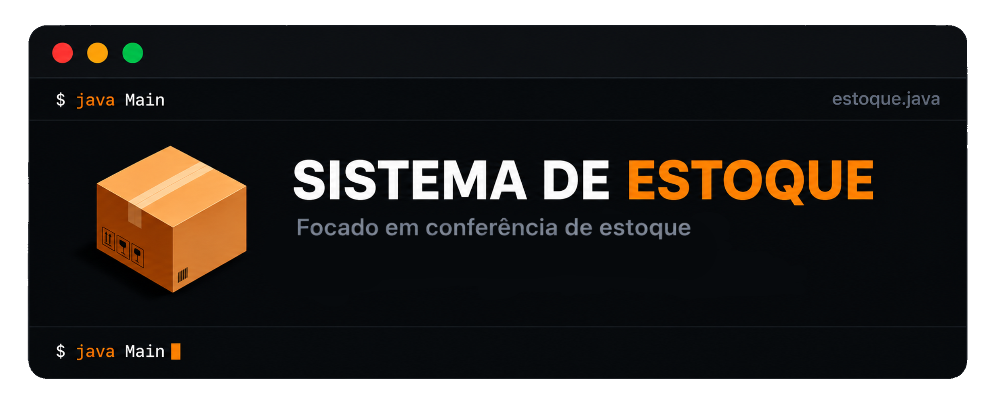
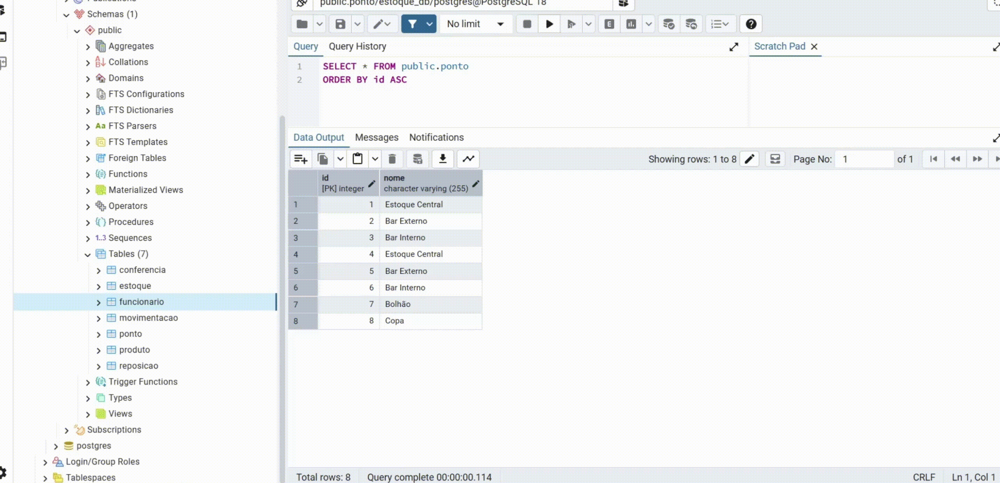

<p align="center">
  
</p>

<p align="center">
  Sistema de conferência de estoque desenvolvido em <strong>Java 17</strong> com API REST e dois painéis (Gerente e Funcionário).
</p>

## Sobre o projeto

O **Estoque-Conferencia** é um sistema de conferência de estoque desenvolvido em **Java 17**, com integração com **PostgreSQL** e **API REST**.

O projeto foi desenvolvido com foco em **rastreabilidade** e **simplicidade** para o funcionário, permitindo registrar reposições, saídas e conferências de estoque.

O sistema calcula automaticamente o estoque esperado:

E registra **quem fez** e **quando** cada movimentação.

## Funcionalidades

* Conferências de estoque
* Reposições
* Saídas
* Cálculo automático de estoque esperado
* Divergências detectadas
* Responsável e data/hora registrados
* Painel do Gerente (visão completa)
* Painel do Funcionário (visão simples)

## Painéis

| Painel | O que mostra |
|--------|--------------|
| Gerente | Estoque inicial, reposições, saídas, esperado, físico, divergência, responsável, data/hora |
| Funcionário | Produto, ponto, físico, divergência, responsável, data/hora |

## Tecnologias

* **Java 17**
* **PostgreSQL**
* **API REST (HttpServer)**
* **HTML/CSS/JavaScript**
* **HikariCP (pool de conexões)**

## Demonstração

<p align="center">
  
</p>

## Como executar

### 1. Clone o repositório

```bash
git clone https://github.com/nahhay/Sistema-de-Estoque-Conferencia.git
cd Sistema-de-Estoque-Conferencia